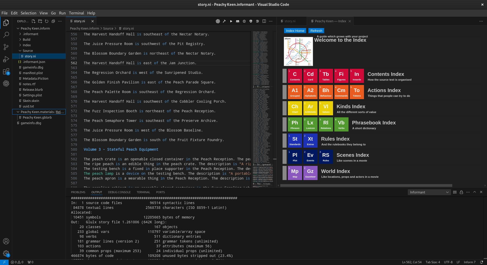

# Informant

**Informant** is a complete, self-contained Inform development environment for
Visual Studio Code. Write, compile, test, and play—no Inform IDE installation required.

Informant brings the Inform development workflow into Visual Studio Code while
preserving native Inform project structures. Its private compiler toolchains
are isolated from other Inform installations on your system, providing a
dependable development environment without altering or depending upon them.

Informant supports the complete authoring cycle, from creating and opening
projects through compilation, integrated playback, generated Inform
documentation and Indexes, Skein recording, and behavioral testing.

## Documentation & Issues

- The complete Informant documentation is available in the
[Informant User Manual](https://interactivefiction.github.io/informant/).
- Report issues to [Informant Github Issues](https://github.com/interactivefiction/informant/issues).

## Features and Capabilities

Informant 1.0.0 provides an end-to-end Inform authoring, compilation, playback,
and testing environment. Current capabilities include:

- Inform 7 language support for `.ni` and `.i7x` files.
- Syntax highlighting and snippets.
- Creation of new Inform projects and support for existing `.inform` projects.
- Private, self-contained Inform compiler toolchains.
- Inform 7 compilation, Inform 6 compilation, and Inblorb packaging.
- Compiler diagnostics through VS Code Problems with jump-to-source support.
- Integrated Inform documentation and generated Index support.
- Integrated Quixe story playback.
- Test-story compilation and playback.
- Skein recording and replay.
- Informant-native `.iskein` test vectors.
- Starter and Continuation Vectors.
- Test Vector Library and Test Manager.
- Reusable `.icomposition` compositions and nested composition playback.
- Continuation recording from test-story and composition playback.
- Project-local testing state isolated within each Inform project.

## License

The Informant VS Code extension is free software released by OpcodeASM under
the GNU General Public License, version 3 only (GPL-3.0-only). You are free to
use, study, modify, and redistribute Informant under the terms of that license.
The complete license terms are provided in the LICENSE file distributed with
Informant.