.. Informant documentation master file.

.. toctree::
   :maxdepth: 2

####################################
Informant Overview
####################################
   
Informant is an integrated development environment for authoring, 
compiling, playing, and testing interactive fiction written with Inform 7.

.. image:: imgs/Informant_1.png
   :alt: Informant environment with project index and code editor open.

Setting it up is as easy as installing a VS Code extension. No additional 
installation of the standard Inform 7 IDE is required. Informant projects 
remain ordinary Inform projects and any Informant-specific state is kept 
separate from the story source so that the project itself remains recognizable 
and useful outside of Informant. Installing Informant will not affect or 
interfere with any other Inform tools you have set up on your computer.  This 
means you can use Informant on the same system as the standard Inform 7 
IDE or even tools like Vimform7.

   
Features
===============

The Informant VS Code extension provides everything needed to develop 
and test an Inform work. Informant deliberately treats the compiler 
toolchain as part of the development environment.  A separate system 
installation of Inform is not required for Informant's normal build 
workflow. Below is a list of the main things you can do with Informant:

* Create a new Inform project.
* Open an existing Inform project.
* Edit Inform source inside Visual Studio Code.
* Compile a story using a managed Inform toolchain.
* Play a story you are working on.
* View compiler errors and build information.
* Jump to line of code when errors are found.
* Read the Inform documentation.
* View the complete generated Inform world index.
* Install ``.i7x`` Inform extensions.
* Record and replay skeins.
* Build interaction vectors and record play sessions for testing.
* Organize reusable tests into collections.
* Run automated tests and compare captured output with expected output.
* Export test results for later inspection.
* Install, manage, and select Inform toolchains.
* Clean generated project files.
* Native compiler toolchains isolated from other Inform
  installations on the computer.

Users of the standard Inform IDE should feel at home with Informant. Many of
the familiar workflows are available, including viewing documentation or
playing a story alongside the source. Informant also supports the other
side-by-side views commonly used while developing an Inform project. Skeins
are the major exception: Informant uses them differently as part of its
recording and testing workflow, as described later in this documentation.

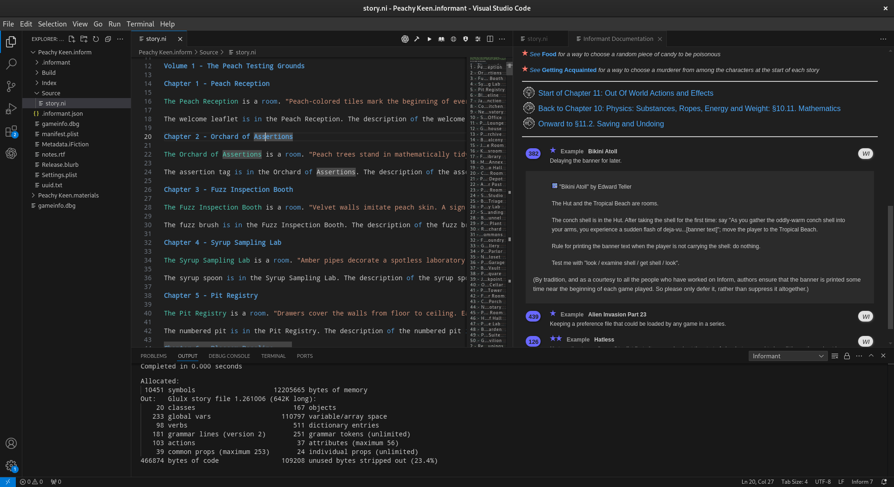

Operating System Support
========================

As of release 1.0 Informant supports the following operating systems
thanks to the broad compatibility of Inform/Inweb/Intest/Quixe and the
VSCode editor:

* macOS (Intel / Arm)
* Windows (10 / 11)
* Linux (RPM / DEB)

Attribution
===============

Informant would not be possible without the hard work of many other people and
I have a deep appreciation for the effort the community has put into keeping the
Inform ecosystem moving forward. All code, binaries, and documentation associated
with Inform, Inweb, Intest, Quixe, Inblorb, Inform IDE, and the Inform Extension
libraries fall under the licensing established by their respective owners.

You can learn more about these projects at the following links:

* `Inweb <https://github.com/ganelson/inweb>`_
* `Intest <https://github.com/interactivefiction/intest>`_
* `Inform <https://github.com/ganelson/inform>`_
* `Inform Website and Documentation <https://github.com/ganelson/inform-website>`_
* `Quixe <https://github.com/erkyrath/quixe>`_
* `Inform 7 IDE for GNOME <https://github.com/ptomato/inform7-ide>`_
* `Windows Inform 7 <https://github.com/DavidKinder/Windows-Inform7>`_
* `Inform for macOS <https://github.com/TobyLobster/Inform>`_
* `Inform 7 Extension Library <https://github.com/i7/extensions>`_

####################################
Getting Started
####################################

Requirements
===============

Informant requires:

* Visual Studio Code.
* The Informant Visual Studio Code extension.

The Inform compiler does not need to be installed separately.  Informant can
install and manage its own toolchains.

Installing VSCode
====================

If you are not familiar with VSCode, you will want to review the two links
below.  The first link explains how to install VSCode for your computer and
there are detailed steps for Windows, macOS, and Linux documented.  The second
link explains something I feel can be a little confusing about VSCode the 
first time you use it... workspace "trust".  In short workspace "trust"
is an action you will take the first time you set up a new project folder to
begin your IF work.  My recommendation is to make a single folder to hold
all of your various IF works and to establish trust for that top level folder.

* `Getting Started with Visual Studio Code <https://code.visualstudio.com/docs/getstarted/overview>`_
* `Visual Studio Code Workspace Trust <https://code.visualstudio.com/docs/editing/workspaces/workspace-trust>`_

Installing Informant
====================

Install Informant through the Visual Studio Code Extensions view.  Open the
Extensions view, search for **Informant**, and install the extension.
Informant may also be installed from a ``.vsix`` package during testing or
when using a package obtained outside of the Visual Studio Marketplace.  In
Visual Studio Code, open the Extensions view, select the ``...`` menu, choose
**Install from VSIX...**, and select the Informant package. After installation, 
Informant commands are available from the Visual Studio Code Command Palette.  
Open the Command Palette and type ``Informant`` to see the commands available.

The Command Palette can be opened using the following keyboard shortcuts:

* **Windows:** ``Ctrl+Shift+P``
* **Linux:** ``Ctrl+Shift+P``
* **macOS:** ``Command+Shift+P``

There are also several ways to open the Command Palette without using a
keyboard shortcut:

* From the menu bar, choose **View > Command Palette...**
* Select the **Manage** gear icon in the lower-left corner of Visual Studio
  Code and choose **Command Palette...**
* On versions of Visual Studio Code that display the Command Center at the
  top of the window, select it and choose or search for a command.

Once the Command Palette is open, type ``Informant``.  Visual Studio Code
will filter the list to show the commands provided by Informant.

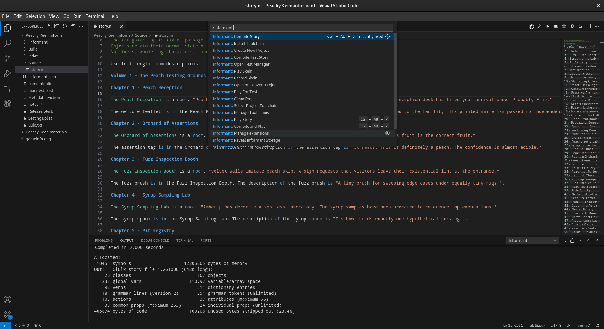

.. list-table:: Informant Commands
   :widths: 35 65
   :header-rows: 1

   * - Command
     - Purpose
   * - Informant: Create New Project
     - Create a new Inform project.
   * - Informant: Open or Convert Project
     - Open or convert an existing Inform project.
   * - Informant: Compile Story
     - Compile the current story.
   * - Informant: Compile and Play
     - Compile the current story and begin playing it.
   * - Informant: Play Story
     - Play the current compiled story.
   * - Informant: Compile Test Story
     - Build the story for the testing workflow.
   * - Informant: Play For Test
     - Play and capture story interaction for testing.
   * - Informant: Record Skein
     - Record a reusable interaction path.
   * - Informant: Play Skein
     - Replay a recorded skein.
   * - Informant: Open Test Manager
     - Open the test collection and playable manager.
   * - Informant: Show Build Errors
     - Show errors from the current build.
   * - Informant: Open Documentation
     - Open Inform documentation.
   * - Informant: Open Index
     - Open the generated Inform Index.
   * - Informant: Install .i7x Extension
     - Install an Inform language extension.
   * - Informant: Clean Project
     - Remove generated build material.
   * - Informant: Install Toolchain
     - Install an Informant compiler toolchain.
   * - Informant: Manage Toolchains
     - Manage installed Informant toolchains.
   * - Informant: Select Project Toolchain
     - Select the toolchain used by the current project.
   * - Informant: Reveal Informant Storage
     - Reveal Informant's managed storage location.
     

   
Workspace Trust
===============

Visual Studio Code may ask whether you trust a folder when it is opened for
the first time.  This is a normal Visual Studio Code security feature. 
If a project is opened in Visual Studio Code's Restricted Mode, functionality 
that requires anything more complex than viewing code will be unavailable.
Only mark a folder as trusted when you trust the files it contains and their
source.

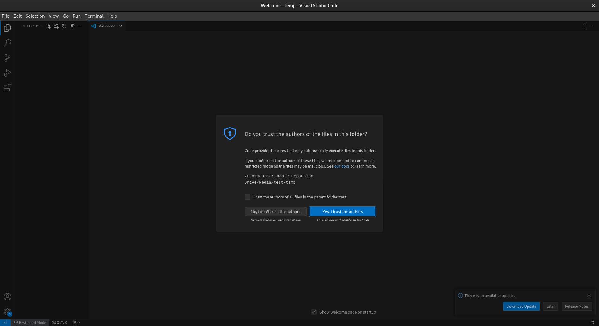

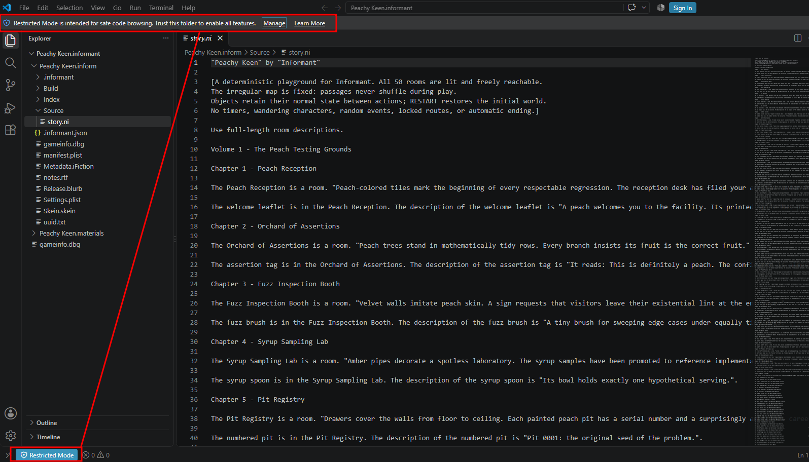

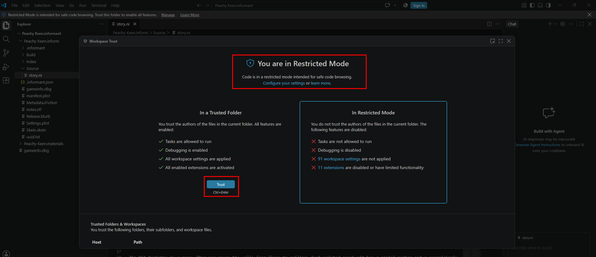

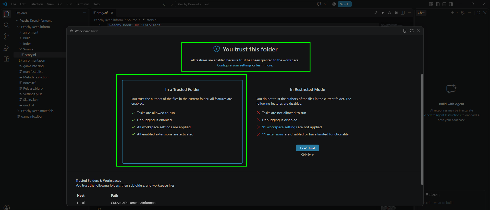

Installing A Toolchain
======================
   
Informant uses self-contained toolchains rather than relying on an Inform
installation elsewhere on the computer. A toolchain contains the native 
compiler programs and the supporting Inform files required by the compiler 
pipeline.  For Inform 10, the principal compiler pipeline is::

   inform7 -> inform6 -> inblorb

Use the following command::

   Informant: Install Toolchain

in VSCode to install an available toolchain.  Informant obtains the appropriate
toolchain archive, verifies it, extracts it into Informant-controlled storage,
and makes it available to projects.  Note: On macOS, Informant uses the 
operating system's ``/usr/bin/curl`` for toolchain acquisition rather than OS 
HTTP services. Hash verification, extraction, installation, and use of the resulting 
package then follow the normal Informant toolchain workflow.

   
Most users will want to download the official Informant toolchain; however, it is
also possible to install toolchains manually if you want to create your own
custom toolkit.  An example of using the download method is illustrated below.

   
After selecting the download option, you will be presented with the latest toolchain
available for your OS.  Informant will always download the most recent production
toolchain.  If you wish to use an older toolchain, you can always obtain the kit
you need from the Informant toolchain github (see below for links).

   
Informant toolchains can be thought of, at a high level, as the basic set of
resources and programs required to deliver an Inform 7 IDE experience.  Generally
speaking, an Informant toolchain package is roughly equivalent to the contents
of the standard Inform IDE distributions with the exception that it simply 
does not contain an IDE. For more information on Informant toolchains, 
how to reproduce them, or to use them in your own projects, please go to:

* `Informant Tool Chain Actions <https://github.com/interactivefiction/informant-toolchains/actions>`_
* `Informant Tool Chain Releases <https://github.com/interactivefiction/informant-toolchains/releases>`_

For completeness, here is a high-level view of the contents of a generic Informant
toolchain package:

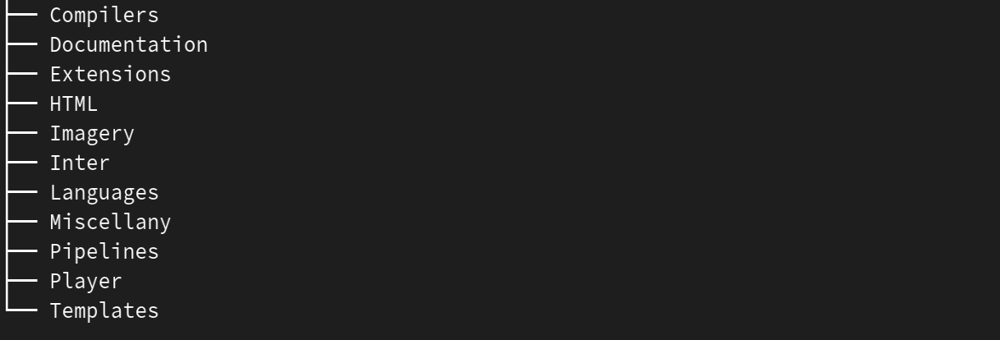

   
Creating Your First Project
===========================

Starting with a new project after you have installed Informant is a simple process
very similar to the steps in the standard IDE.  However, in the case of Informant you will
use the VSCode palette command and follow the prompts to choose the location 
and name of the project.::

   Informant: Create New Project

Informant creates the project structure required for an Inform work and opens
the project in Visual Studio Code.  The story source can then be edited in the
normal Visual Studio Code editor. If Visual Studio Code asks whether the newly 
opened project folder should be trusted, review the folder and grant trust 
before compiling or running the story.  Below is an image of the dialog box
associated with creating a new project.

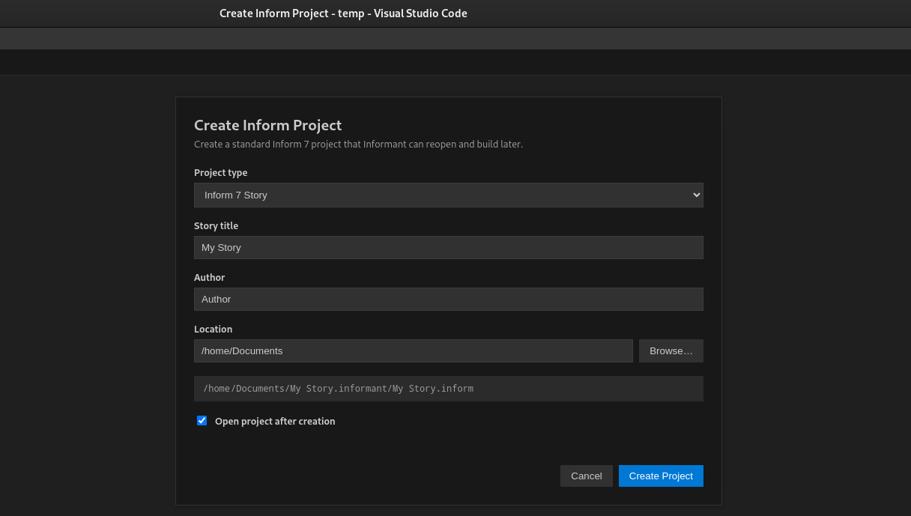

Once your new project is created, you will need to browse into the source folder
and choose the story.ni file so you can begin editing.  The image below shows
the source folder open and the story.ni selected and opened for editing.

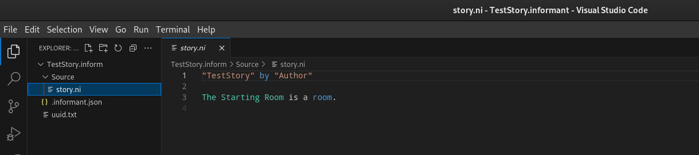

Quick Actions & Shortcuts
=========================

When you are editing source code using Informant, you will likely want to quickly
compile your code, play your project, or perform many of the other Informant
commands without needing to access the command palette.  Informant allows you to
pin your favorite commands to upper-right side of the editor window.  One shortcut
is always available in the right corner of the editor screen: Source Action Settings.
Activating this opens a check box list that allows you to choose which shortcuts are
pinned to the right corner of your editor screen.  In practice the total number of 
shortcuts will vary depending on other extensions you may have installed, the resolution
of your screen, and other factors.  Experiment with the shortcuts and find a configuration
that works best for your workflow!  The image below illustrates the quick actions on the
right side of the editor screen and the check box list that can be opened using the
three-slider icon to the rightmost side of the quick action icon list.

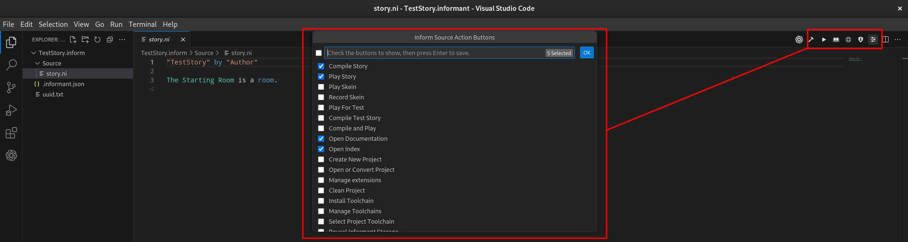

     
####################################
Projects
####################################

Opening A Project
=================

Informant can open standard Inform projects in addition to Informant projects.
When working with a standard Inform project, Informant will create a .informant
folder alongside the .inform folder representing your project in order to allow
you to use the various skein / vector / composition features of Informant.  This
folder can be deleted if you do not need it later. Use the following command to 
select an existing Inform or Informant project::

   Informant: Open or Convert Project

Alternatively, you can also open a project directly by simply opening its folder.
This method will bypass the option to convert the project to an Informant project.
Many times this approach is used when using Informant for the first time.

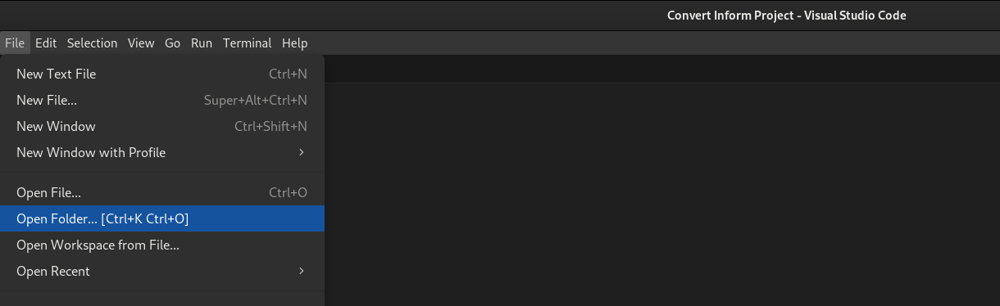

Understanding an Inform Project
===============================

When an Inform project is opened in Informant, its files and directories are
displayed in the Visual Studio Code Explorer.  This provides direct access to
the normal structure of an Inform project rather than hiding the project behind
a specialized editor interface.

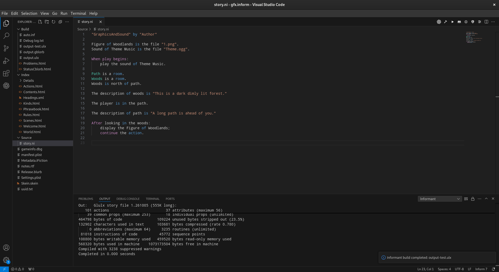

A typical project contains three primary directories:

.. code-block:: text

   Project.inform/
   ├── Build/
   ├── Index/
   └── Source/

These directories contain the source text of the story along with files
generated by Inform during compilation.

Source
=================

The ``Source`` directory contains the Inform source code for the project.  The
main source file is:

.. code-block:: text

   Source/
   └── story.ni

``story.ni`` is the primary source file for an Inform project.  This is where
rooms, objects, actions, rules, descriptions, and the other elements of the
story are normally written. Informant opens and edits ``story.ni`` as a normal 
text file in Visual Studio Code.  In the example shown above, ``story.ni`` 
contains a small story defining two rooms as well as an image and a sound resource.
Depending upon the project and the version of Inform being used, the
``Source`` directory may also contain additional files maintained by Inform.

Build
=================

The ``Build`` directory contains intermediate and final files produced while
the story is being compiled. In the example above it contains files such as:

.. code-block:: text

   Build/
   ├── auto.inf
   ├── Debug log.txt
   ├── output-test.ulx
   ├── output.gblorb
   ├── output.ulx
   ├── Problems.html
   └── StatusCblorb.html

``auto.inf`` is generated from the Inform source during compilation and is
used as input to the Inform 6 compiler. Story files such as ``output.ulx`` 
and ``output.gblorb`` are compiled forms of the project.  The exact files 
present in ``Build`` depend upon how the project was compiled and packaged.
Inform also places diagnostic and status information in this directory.
Files such as ``Problems.html`` and ``StatusCblorb.html`` may therefore appear
as part of the build process. These are build products rather than the 
author's primary source text.  In normal use they are generated and updated 
by the Inform toolchain.

Index
=================

The ``Index`` directory contains the Inform Index generated when the project
is compiled. In the example above it contains files such as:

.. code-block:: text

   Index/
   ├── Details/
   ├── Actions.html
   ├── Contents.html
   ├── Headings.xml
   ├── Kinds.html
   ├── Phrasebook.html
   ├── Rules.html
   ├── Scenes.html
   ├── Welcome.html
   └── World.html

The Index is generated from the project and describes the structure Inform
has discovered in the source.  Among other things, it can provide information
about the story world, actions, rules, scenes, kinds, phrases, and source
headings. Informant can display this generated Index alongside the source code, 
allowing the author to move between writing the story and examining Inform's 
analysis of it without leaving Visual Studio Code.

Other Project Files
===================

An Inform project can also contain files at the project level.  The example
shown above includes:

.. code-block:: text

   gameinfo.dbg
   manifest.plist
   Metadata.iFiction
   notes.rtf
   Release.blurb
   Settings.plist
   Skein.skein
   uuid.txt

These files are part of the surrounding Inform project and may contain project
settings, release information, metadata, notes, debugging information, skein
data, or other information used by Inform and its development tools. Not every 
project will contain exactly the same set of generated files.  Some files appear 
only after particular build or release operations, and the contents of the 
project can vary between Inform versions.

Working With the Project in Informant
=====================================

Although Visual Studio Code makes the entire project visible, authors will
normally spend most of their time editing:

.. code-block:: text

   Source/story.ni

The remaining directories and files provide the supporting structure used by
Inform to compile, analyze, test, and package the story. Making this structure 
visible is also useful when diagnosing a build, examining generated output, 
or working with different Inform toolchains. Informant does not require the 
project to be converted into a separate Informant-specific project format; 
the Inform project itself remains the project.

The Informant Project Structure
===============================

Informant can convert an existing Inform project into an Informant project.
This conversion is **nondestructive**.  Informant does not modify or replace
the original Inform project.  Instead, it creates a copy of the project using
the Informant project directory structure, leaving the original project intact.

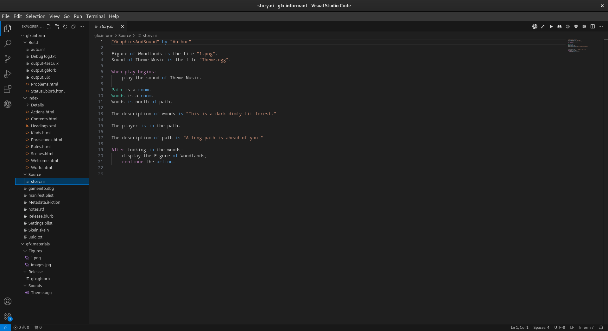

The screenshot above shows the same Inform project used in the previous
example after it has been converted into an Informant project. At the top level, 
the Informant project brings the Inform project and its associated materials 
together:

.. code-block:: text

   Informant Project/
   ├── gfx.inform/
   └── gfx.materials/

The ``gfx.inform`` directory contains the familiar Inform project structure.
Its ``Build``, ``Index``, ``Source``, and other Inform files remain organized
as expected by Inform. The ``gfx.materials`` directory contains the resources 
associated with the story:

.. code-block:: text

   gfx.materials/
   ├── Figures/
   │   ├── 1.png
   │   └── images.jpg
   ├── Release/
   │   └── gfx.gblorb
   └── Sounds/
       └── Theme.ogg

A More Complete View of the Project
===================================

One of the benefits of the Informant project structure is that the source and
the materials belonging to the story are visible together in the Visual Studio
Code Explorer. In a traditional Inform project view, the author primarily sees 
the contents of the ``.inform`` directory:

.. code-block:: text

   gfx.inform/
   ├── Build/
   ├── Index/
   ├── Source/
   └── ...

After conversion, Informant presents the larger project:

.. code-block:: text

   Informant Project/
   ├── gfx.inform/
   │   ├── Build/
   │   ├── Index/
   │   ├── Source/
   │   └── ...
   │
   └── gfx.materials/
       ├── Figures/
       ├── Release/
       └── Sounds/

This provides a more holistic view of the story.  Source code, figures, sounds,
generated Inform files, and release artifacts can all be reached from the same
workspace. The relationship is particularly useful when working with multimedia.  
In the example above, the source contains:

.. code-block:: inform7

   Figure of Woodlands is the file "1.png".
   Sound of Theme Music is the file "Theme.ogg".

The corresponding files are immediately visible in ``gfx.materials/Figures``
and ``gfx.materials/Sounds``.  The author can therefore see both the source
declaration and the resources it refers to as parts of the same project.

Nondestructive Conversion
=========================

Converting an existing project to the Informant project structure does not
alter the original project.  Informant creates a separate copy for use with
Informant and leaves the original Inform project intact. This makes it possible 
to bring an existing Inform project into Informant without sacrificing the 
original project or requiring it to be permanently migrated away from its 
existing form.

Converting Existing Inform Projects
===================================

Informant allows you to convert existing Inform projects to have the same 
structure as an Informant project.  This process is non-destructive and the
original Inform project remains as is.  To perform the conversion, Informant
makes a copy of the original inform project to create the Informant version.
When you use the Open Project command, the option to convert the project
is available if you are opening a standard Inform project.

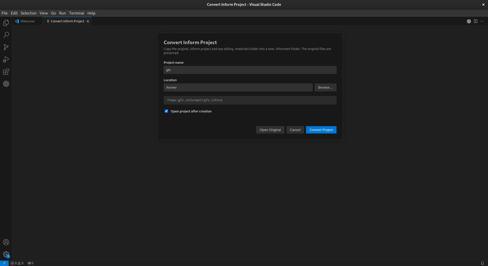

The primary difference between an Inform project and an Informant project is
directory structure.  Informant projects include the .materials folder in 
addition to the standard .inform project folder.  The .informant folder acts
as a container for both of these folders.  This was done in order to allow
for access to the .materials folder within the context of VSCode.  This is
helpful when working with or adding files to the materials folder while
developing your project.

Saving A Project
================

Story source is edited and saved using the normal Visual Studio Code editing
commands.  Informant does not replace Visual Studio Code's normal file
editing and saving behavior.

Project State Details
=====================

An Informant project contains a ``.informant`` directory used to store
Informant-specific project state. Unlike the ``.inform`` and ``.materials``
directories described above, the contents of ``.informant`` are maintained by
Informant and support features provided by the extension rather than by the
Inform compiler itself. Keeping this information in a separate directory
allows Informant to add project management and testing facilities without
altering the underlying structure of the Inform project.

.. code-block:: text

   .informant/
   ├── collections/
   ├── compositions/
   ├── test-vectors/
   ├── working/
   └── informant.json

The ``informant.json`` file contains Informant project state and configuration.
The remaining directories contain data used by Informant's recording and
testing system. In particular, ``test-vectors``, ``compositions``, and
``collections`` provide the persistent representation of the tests displayed
and managed through the Informant Test Manager.

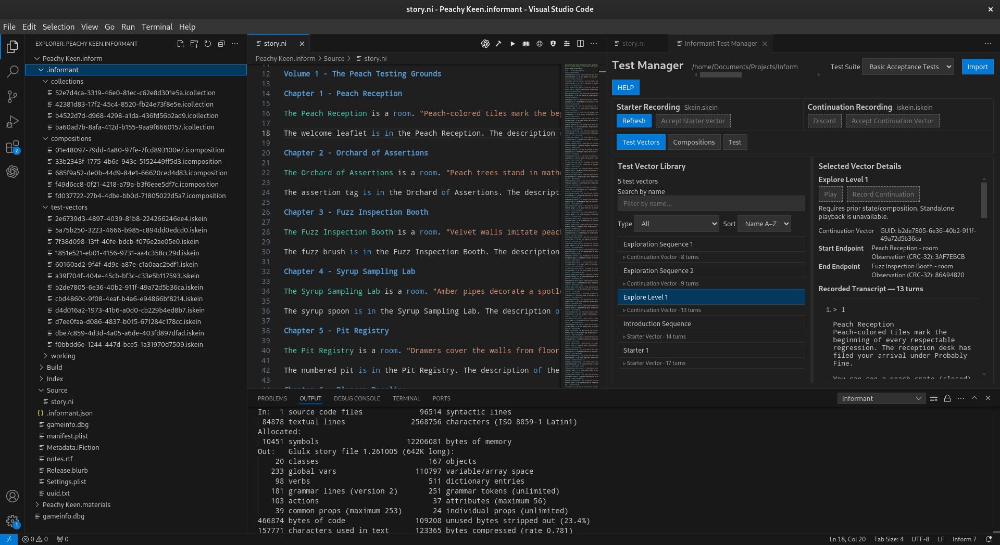

The ``test-vectors`` directory contains recorded test vectors. Each vector is
stored in an Informant-specific ``.iskein`` file. A test vector records a
sequence of player commands and the corresponding story interaction captured
during recording, allowing that sequence to be played again or used as part of
a larger test. The screenshot above shows these files in the Explorer while the
same recorded vectors appear in the **Test Vector Library** of the Test Manager.
Selecting a vector in the Test Manager exposes information about the recording,
including its endpoints and recorded transcript.

.. code-block:: text

   .informant/
   └── test-vectors/
       ├── <guid>.iskein
       ├── <guid>.iskein
       └── ...

The filenames use identifiers rather than the descriptive names displayed in
the Test Manager. Informant maintains the relationship between the stored
objects and their user-facing representation, so authors normally work with
these recordings through the Test Manager rather than by editing the files
directly.

The ``compositions`` directory contains ``.icomposition`` files. A composition
is an Informant-specific structure that combines recorded vectors into an
ordered playable sequence. This allows smaller recordings to be reused as
building blocks for longer interactions instead of requiring every complete
test path to be recorded independently.

.. code-block:: text

   .informant/
   └── compositions/
       ├── <guid>.icomposition
       ├── <guid>.icomposition
       └── ...

Compositions are managed through the **Compositions** portion of the Test
Manager. The files in this directory are the persistent project data behind
those compositions.

The ``collections`` directory contains ``.icollection`` files. Collections are
Informant's organizational layer for grouping playables into test suites. They
allow related tests to be collected and selected as a unit when testing a
story.

.. code-block:: text

   .informant/
   └── collections/
       ├── <guid>.icollection
       ├── <guid>.icollection
       └── ...

In the screenshot above, the Test Manager has the **Basic Acceptance Tests**
suite selected. The collection data stored under ``.informant/collections`` is
what allows these project-specific test groupings to persist between Informant
sessions.

The ``.iskein``, ``.icomposition``, and ``.icollection`` file types are
Informant-specific XML formats. Together they form the persistent data model
used by Informant's recording and testing facilities.

.. code-block:: text

   .iskein        Recorded test vector
   .icomposition  Ordered composition of vectors
   .icollection   Collection of playables used as a test suite

These files are deliberately stored as part of the Informant project rather
than inside the Inform source tree. This keeps Informant's testing state
separate from the files belonging to Inform itself while allowing the tests to
travel with the Informant project.

The Test Manager provides the user-facing view of much of the information
stored beneath ``.informant``. Recordings made while playing the story become
test vectors, vectors can participate in compositions, and playables can be
organized into collections for repeated testing. The Explorer therefore shows
the persistent files that make up the testing system while the Test Manager
presents those same concepts in a form intended for everyday use.

The distinction is useful when understanding an Informant project: the
``.inform`` directory contains the Inform project, the ``.materials`` directory
contains resources associated with the story, and the ``.informant`` directory
contains the additional state Informant uses to manage and test that project.
Together they allow Informant to treat the source, resources, and behavioral
tests as parts of the same development environment.

####################################
Compiling And Playing
####################################

Compile Story
=============

When you compile a story Informant invokes the selected project toolchain and drives 
the Inform build pipeline.  A successful release build ultimately produces the 
playable story artifact, including ``.gblorb`` output where appropriate. Compiling
a story for general play is not the same as compiling a story for test.  This is a
minor but important distinction.  Compile for test has a different goal and enables
the use of Inform "test X with" behaviors. To compile the current project, use::

   Informant: Compile Story

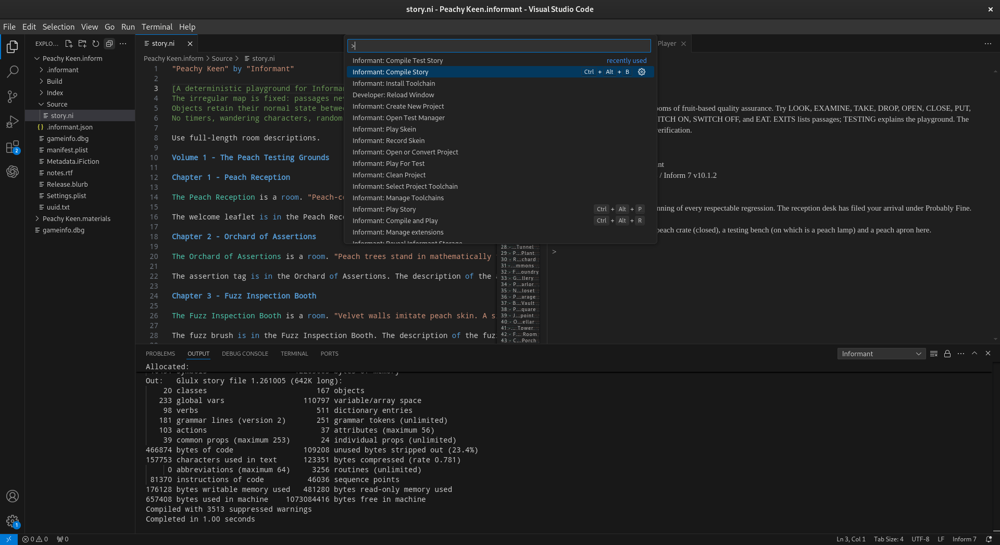

Compile And Play
================

Many times developers will want to compile and immediately play their interactive
fiction work.  There is a dedicated command for this action as it is quite common.
When you want to build the current source and immediately begin playing the
result, just use::

   Informant: Compile and Play

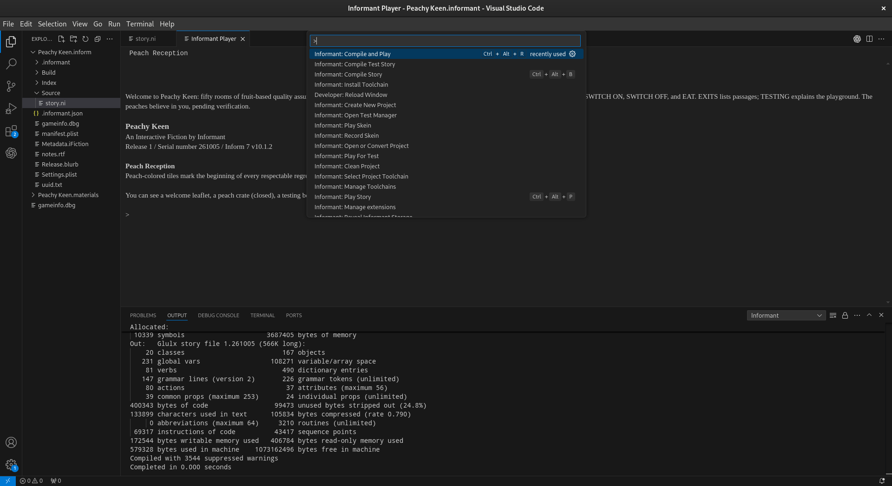

Play Story
==========

Sometimes developers may want to play the current compiled story without recompiling
from their source code.  This comes up when the story is in an intermediate or 
incomplete state. To run the current story without recompiling, use::

   Informant: Play Story

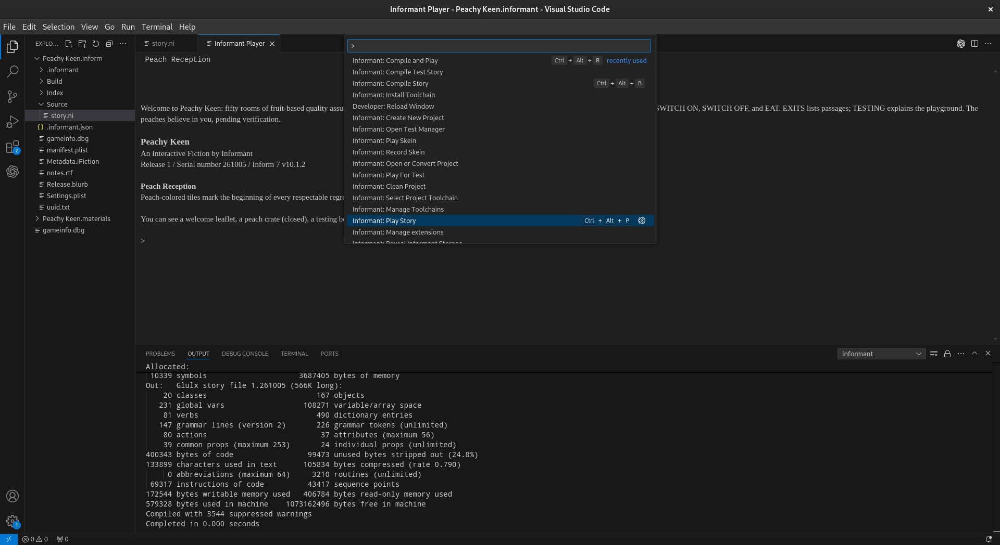

Build Errors
============

During development there will inevitably be build errors you will need to fix.
As much as possible Informant works to parse these errors from the Inform compiler
output and provide an easy to navigate enumeration of the errors that will 
take you directly to the line of source creating the error.  It is important
to note that compiler errors remain compiler errors: Informant presents the build
information so that the source can be corrected in Visual Studio Code and
compiled again. It does not correct errors for the user.

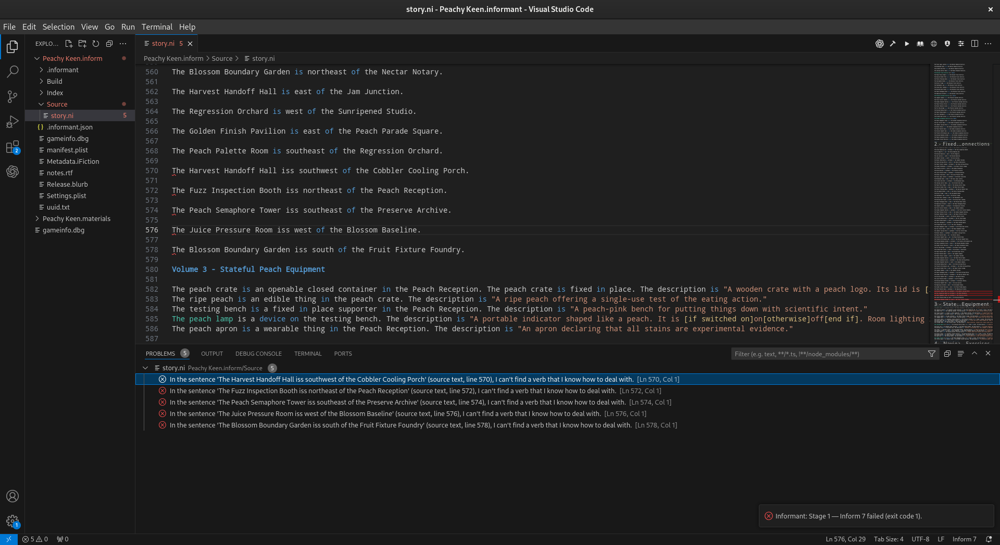

Cleaning A Project
==================

Cleaning a project simply deletes the Inform build folder.  To remove generated 
build material and prepare the project for a clean build just use::

   Informant: Clean Project

####################################
Inform Documentation And Index
####################################

Inform Documentation
====================

The standard Inform IDE has extensive documentation integrated into its workflow.
That same documentation has been integrated into Informant as much as possible.
Due to some limitations of VSCode there are differences in its overall presentation.
Use the following command to open the Inform documentation in the development
environment::

   Informant: Open Documentation

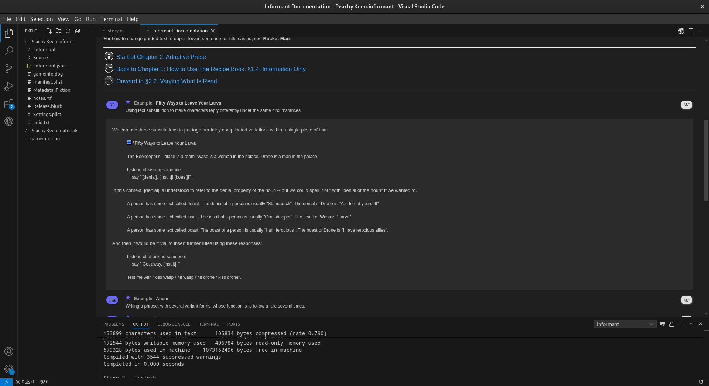

Inform Index
============

The Inform Index is produced by Inform and provides detailed information about 
the compiled world, including material derived from the story source. To open the 
index generated for the current Inform project, use the following command::

   Informant: Open Index

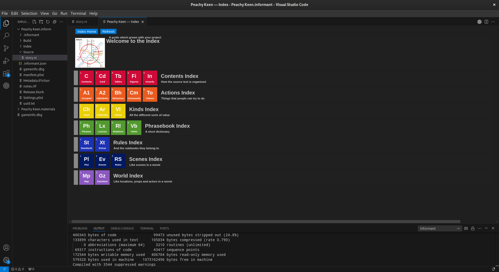

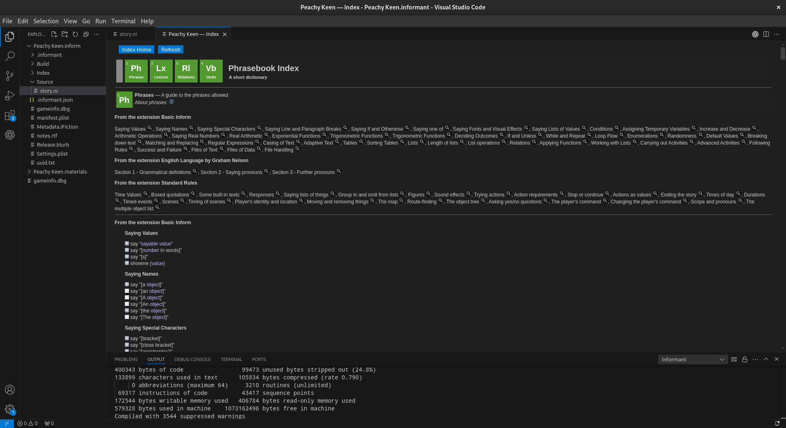

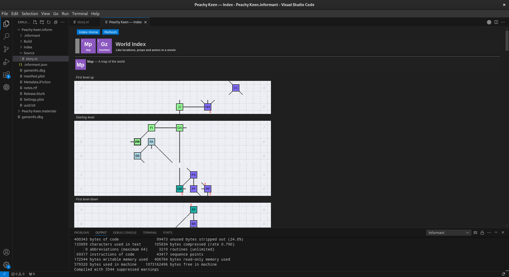

####################################
Inform Extensions
####################################

Inform extensions use the ``.i7x`` file format. To install an Inform extension for 
use by the Inform development environment you can use the following command::

   Informant: Install .i7x Extension

A descriptive catalog of various Inform extensions is available: 

* `Informant i7x Extension Guide <https://interactivefiction.github.io/inform7extensions/>`_

NOTE: This command is for Inform language extensions and should not be confused
with Visual Studio Code extensions.  Informant itself is a Visual Studio Code
extension; an ``.i7x`` file extends Inform.

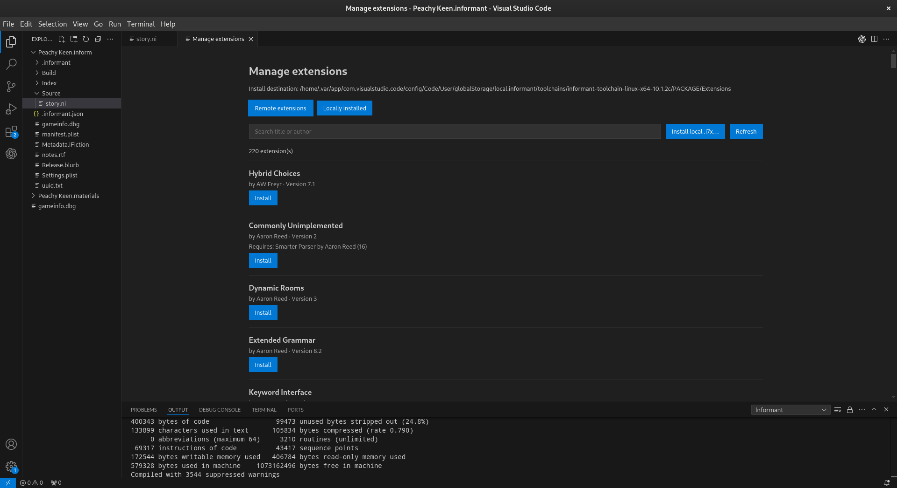

Types Of Extensions
===================

There are a wide variety of extensions available for Inform.  Conceptually it can
be helpful to organize them into functional categories according to their primary 
purpose. Some extensions naturally overlap more than one area, so the categories 
should be treated as a browsing aid rather than as a strict classification of the 
Inform extension ecosystem. The broad categories are enumerated below and for 
detailed information about the extensions, please see the Inform7 Extension Guide
located here: >link<

* Conversations, Characters & NPCs
* General Utilities & Miscellaneous
* Multimedia: Graphics & Sound
* Objects, Actions & Physical Interaction
* Parser, Commands & Input
* Release, Metadata & Licensing
* Rules, Relations & Programming Utilities
* Saving, Files & Persistence
* Story Structure, Choice & Narrative
* Testing, Debugging & Development
* Text, Prose & Output
* Time, Events & Turn Structure
* User Interface, Windows & Typography
* World Model, Rooms & Mapping

####################################
Skeins And Recorded Play
####################################

Inform's Skein provides a visual history of play. It records commands as a
branching structure, allowing an author to preserve different routes through a
story and return to earlier points in a play session. Informant repurposes that
existing structure as the source material for a testing model. The important change 
is not that Informant replaces the Skein. It does not. The Inform Skein remains the 
author's original branching record of play. Informant interprets that record, breaks 
its paths into reusable pieces, and uses those pieces to construct persistent test 
vectors, compositions, and test collections. This gives the same recorded play two 
useful views. In the Inform IDE, the Skein is primarily a branching visual history. 
In Informant, that history can be translated into reusable behavioral test material.

The Skein in the Inform IDE
===========================

In the Inform IDE, a Skein can be read as a tree of commands. Play begins at a
common starting point and branches whenever different commands are recorded
from an earlier point. For example, a Skein may contain several routes beginning 
at ``start``::

                         start
                        /     \
                      look    take all
                     /   \        |
                take all  ...   open crate
                   |              |
                   ...            ...

The diagram is useful because it shows both common history and divergence.
Several complete routes through the story may share the same beginning, while
later commands distinguish one route from another.

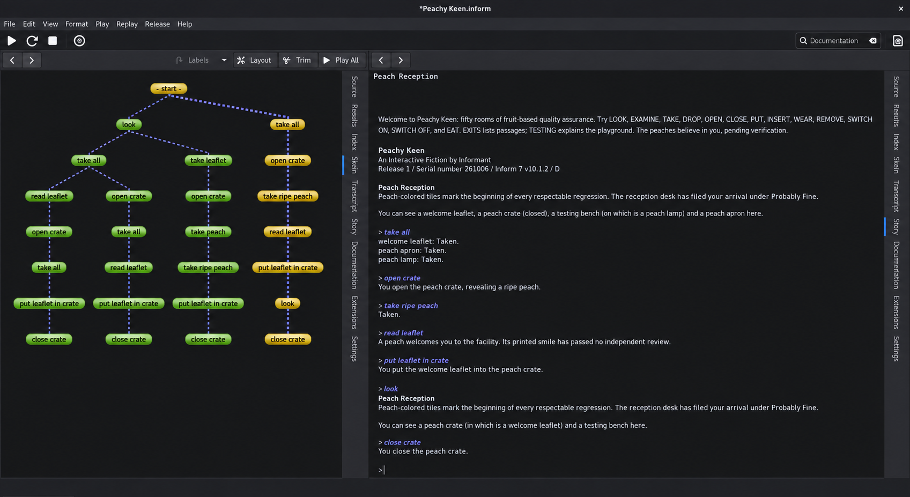

   A Skein in the Inform IDE. Commands are represented as nodes in a branching
   history of recorded play.

Informant's Interpretation of the Skein
=======================================

Informant treats the Skein as more than a picture of a play session. The
branching structure contains information that can be transformed into testing
material. Rather than storing every complete root-to-leaf route as an unrelated 
block of commands, Informant can decompose the Skein into reusable pieces. Shared or
independently meaningful portions become test vectors, while complete playable
routes can be represented by compositions that refer to those vectors.

Conceptually, the transformation is::

                         INFORM SKEIN
                              |
                              v
                   Analyze branching paths
                              |
                  +-----------+-----------+
                  |                       |
                  v                       v
             Test Vectors            Compositions
           reusable pieces         playable routes
                  |                       |
                  +-----------+-----------+
                              |
                              v
                      Qualified Tests
                              |
                              v
                       Test Collections

This is a change in representation, not a loss of the original idea. The
branching play recorded by Inform is retained as behavioral structure, but
Informant expresses that structure in forms that are easier to reuse, combine,
organize, and execute as tests.

Test Vectors: ``.iskein``
=========================

The smallest persistent behavioral unit produced or used by Informant is a
test vector, stored as an ``.iskein`` file. A vector records a sequence of player 
commands and the corresponding observed story output. Informant distinguishes 
between vectors that can begin from a fresh story and vectors that continue from 
an established state. A simple decomposition can therefore look like this::

                         original branch
                              |
              +---------------+---------------+
              |                               |
              v                               v
        Starter Vector                 Continuation Vector
       begins the playable             continues from an
           sequence                    established endpoint

When a Skein branches, this separation prevents Informant from having to copy
the same recorded material into every complete route. The imported Skein can
instead become a set of pieces that describe the useful portions of its graph.
In the example import shown here, Informant decomposed the Skein into one
starter vector and four continuation vectors.

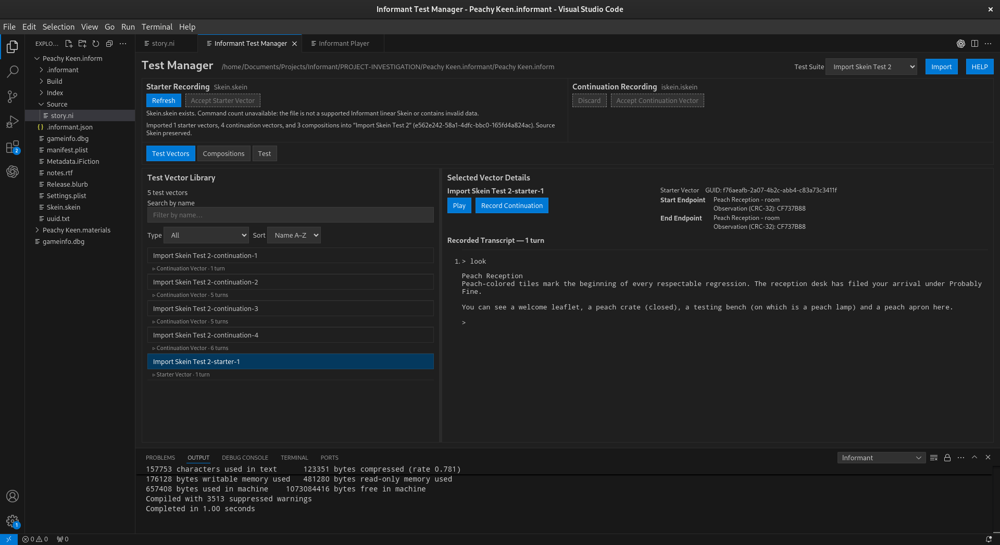

   The Test Vector Library after Skein import. The original branching history
   has been decomposed into starter and continuation vectors.

Endpoints and Compatibility
===========================

A continuation is meaningful only in the correct story state. Informant
therefore records endpoint information for vectors and uses that information
when reasoning about how recorded pieces may connect. This distinction is important. 
Two vectors may appear structurally compatible without being proven behaviorally 
interchangeable. Informant can identify structural candidates and endpoint relationships, 
but structural similarity is not itself proof that two pieces of recorded play have 
the same behavioral meaning. The endpoint model allows Informant to preserve an 
important property of the original Skein: branches occur in a particular story context. 
A continuation is not merely a loose list of commands; it belongs after a state from which
that continuation makes sense.

Compositions: ``.icomposition``
===============================

Breaking the Skein into reusable vectors would not be sufficient by itself.
The complete routes through the original branching structure also matter.
Informant represents those routes as compositions, stored as
``.icomposition`` files. A composition is an ordered sequence of vectors that
together describe a playable path.

For example::

              +------------------+
              |  Starter Vector  |
              +--------+---------+
                       |
             +---------+---------+
             |                   |
             v                   v
      Continuation A      Continuation B
             |                   |
             v                   v
      Composition 1       Composition 2

The vectors preserve reusable pieces. The compositions preserve meaningful
ways of putting those pieces back together. During the example import, Informant 
created three compositions from the branching Skein in addition to the five vectors. 
Those compositions correspond to complete playable routes reconstructed from the 
imported material.

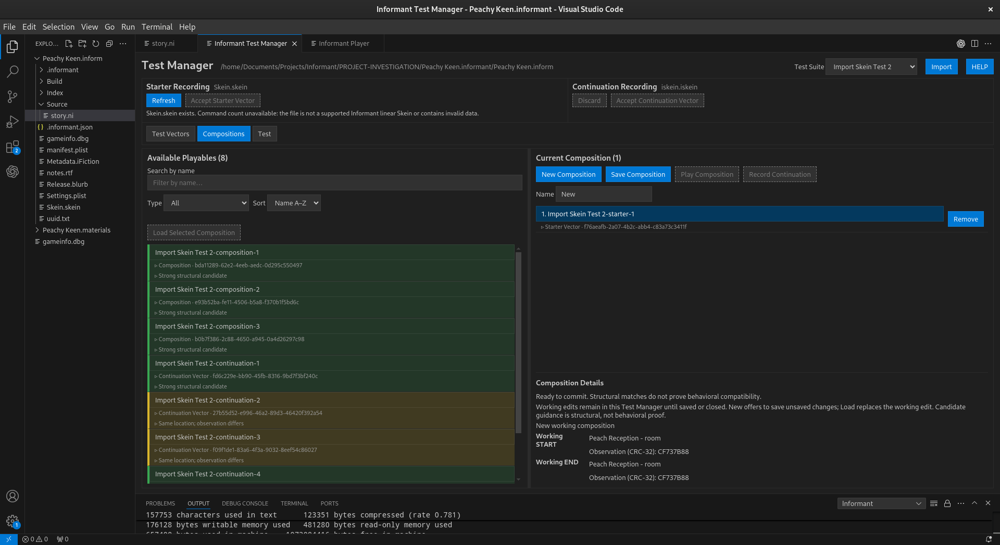

   Imported compositions preserve complete playable routes through the
   decomposed Skein.

From Recorded Play to Executable Tests
======================================

A major consequence of the transformation is that suitable imported material
can become executable regression tests. Informant's Test view lists independent 
Playables with qualified start and end endpoints. A starter vector may qualify by 
itself. A composition may qualify when its ordered vectors form a complete playable 
route. Continuation vectors that depend on prior state do not become independent 
tests merely because they exist in the library. The relationship can be summarized as::

        Inform Skein
             |
             v
      +--------------+
      | Decomposition|
      +------+-------+
             |
       +-----+------+
       |            |
       v            v
    .iskein    .icomposition
    vectors       routes
       |            |
       +-----+------+
             |
      qualified Playables
             |
             v
       regression tests
             |
       PASS / FAIL result

In the example shown, the import produced four independently runnable tests:
one starter vector and three compositions. Running all four against a fresh
story produced four passing results.

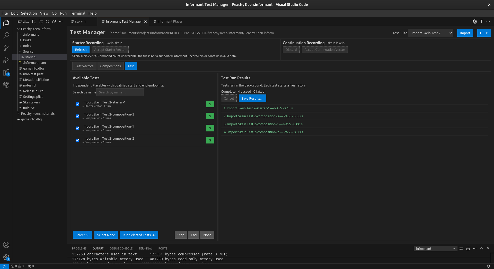

   Imported Skein material used as executable tests. Each independent test
   begins with a fresh story and compares recorded behavior with current
   behavior.

This is the central repurposing of the Skein in Informant. A history that was
originally useful for recording and revisiting play can also become a durable
description of expected story behavior.

Collections: ``.icollection``
=============================

Vectors and compositions describe behavior. Collections provide organization.
An Informant collection, stored as an ``.icollection`` file, groups Playables
into a named test suite. Collections make it possible to organize the tests
derived from recorded play according to the author's needs rather than
according to the geometry of the original Skein. The relationship among the 
three Informant formats is therefore::

                         .icollection
                        named test suite
                              |
                +-------------+-------------+
                |                           |
                v                           v
          .icomposition                 .iskein
          ordered route              complete vector
                |
        +-------+-------+
        |               |
        v               v
     .iskein         .iskein
     vector          vector

An ``.iskein`` is recorded behavioral material. An ``.icomposition`` combines
vectors into an ordered playable route. An ``.icollection`` organizes
Playables into a test suite. The collection is not another branch of the original 
Inform Skein. It is a higher-level Informant organization built from the testing 
material obtained from recorded play.

Two Views of the Same Recorded Play
===================================

The distinction between Inform and Informant can be summarized as follows:

.. list-table::
   :header-rows: 1
   :widths: 28 34 38

   * - Concept
     - Inform IDE
     - Informant
   * - Recorded play
     - Displayed as a branching Skein
     - Interpreted as behavioral test material
   * - Shared path
     - Visible as common nodes in the tree
     - Can be represented by reusable vectors
   * - Branch
     - A route through Skein nodes
     - Can be reconstructed as a composition
   * - Continuation
     - Commands following an earlier Skein state
     - A continuation vector tied to an endpoint
   * - Complete route
     - A path through the Skein
     - A qualified Playable that can become a test
   * - Organization
     - Primarily the Skein's branching geometry
     - Named collections of Playables
   * - Verification
     - Recorded history can be replayed
     - Recorded behavior can be executed and compared as a regression test

The Translation at a Glance
===========================

The complete conceptual progression is::

        INFORM IDE
        ==========
        Skein.skein

        branching recorded play
                |
                |  import and analyze
                v

        INFORMANT
        =========

        .iskein
        test vectors
        reusable recorded behavior
                |
                +-------------------+
                |                   |
                v                   v
        starter vectors      continuation vectors
                \                   /
                 \                 /
                  +-------+-------+
                          |
                          v
                    .icomposition
                 ordered playable route
                          |
                          v
                   qualified Playable
                          |
                          v
                    executable test
                          |
                          v
                     .icollection
                    organized suite

This model lets Informant reuse work authors may already have performed while
developing and playing their stories. The Skein remains recognizable as the
source of that work, while Informant gives its branches a second life as
persistent, composable, executable regression material.

Why Repurpose the Skein?
========================

Interactive fiction testing has an unusual advantage: ordinary play naturally
produces sequences of commands and observable responses. The Inform Skein has
long provided a way to preserve that play as a branching history. Informant
builds on that idea by treating recorded play as potential test evidence.
The result is a bridge between exploration and verification. An author can
record behavior while developing a story, import that behavior into Informant,
retain reusable portions as vectors, preserve complete routes as compositions,
organize useful Playables into collections, and execute qualified Playables as
regression tests. In that sense, Informant does not discard the Skein model. 
It changes the question asked of it. The Inform IDE asks, in effect, 
"How did play get here, and what other branches were recorded?"

   
Record Skein
============

In the standard Inform IDE, a skein is generally recorded when you play your
work using the player that is built into the Inform IDE.  This generates a skein
representative of the paths you have traversed during your game play.  The skein
is cumulative, allowing you to visualize various paths you have exercised during 
your development work.  There are, however, some downsides to this approach.  The
most apparent is the ongoing skein pruning or trimming that must be performed to
ensure that the skein does not become too large or even problematic for the 
normal functioning of the IDE.  Despite these limitations the skein is very helpful
in the creation of IF works.  Informant takes the concept of the skein and adapts 
its behavior to fit a more test driven methodology.  First and foremost, within the 
context of Informant, a skein only represents a single path of play through your 
game.  That path starts at the beginning of the IF work and ends wherever you stop
recording commands.  A skein must be explicitly recorded.  Skeins are not automatically 
recorded during game play.  Your recorded skein acts as a temporary command sequence 
that you can play back over and over as needed.  The concept of a branching skein does 
not exist in informant and instead, branching, alternative paths, etc... are the domain 
of several new concepts: iskein, icomposition, and icollection which will be described 
in more detail elsewhere in this documentation.  For now, to record a skein you can use 
the command::

   Informant: Record Skein

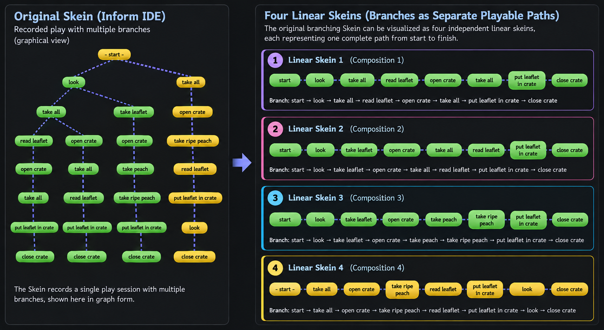

Play Skein
==========

Skeins are especially useful for repeatedly reaching a particular part of a story while 
developing it. Use the following command to replay a previously recorded skein::

   Informant: Play Skein

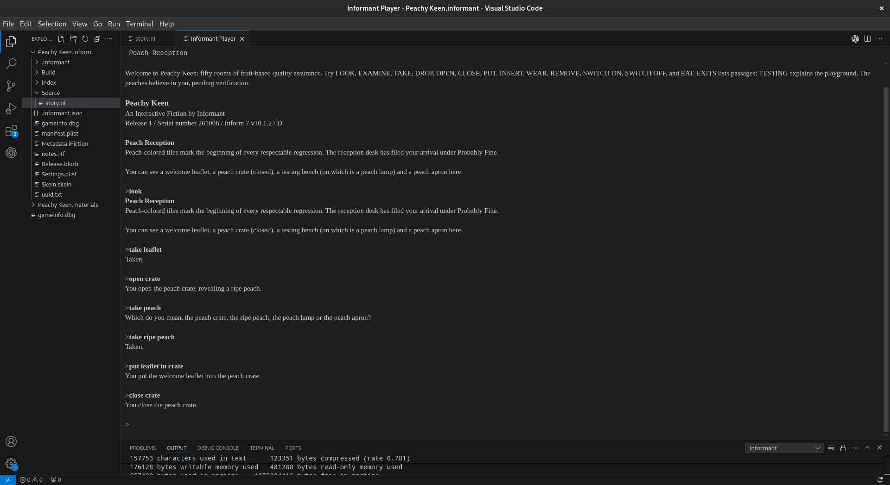

####################################
Testing
####################################

Interactive fiction presents a different testing problem from conventional
software. A command is not evaluated in isolation. Its behavior depends upon
the accumulated state of the story when the command is entered. The player's
location, inventory, object properties, scenes, counters, rules that have
already fired, and other story state may all affect what happens next.
Informant therefore does not attempt to reduce an interactive-fiction world
to isolated deterministic commands. Instead, it records self-contained paths
through the story, preserves useful portions of those paths as test vectors,
and reconstructs longer paths when later behavior depends upon state created
earlier in play.

The central principle is:

    **Informant treats recorded play as behavioral evidence.**

That evidence begins with recording a Skein. A useful recorded path can become
a starter vector. A starter can then be replayed to establish the state from
which continuation vectors are recorded. Compositions join a starter with one
or more compatible continuations. Endpoint qualification determines which
resulting Playables can make meaningful regression assertions, while
collections organize those Playables into testing strategies.

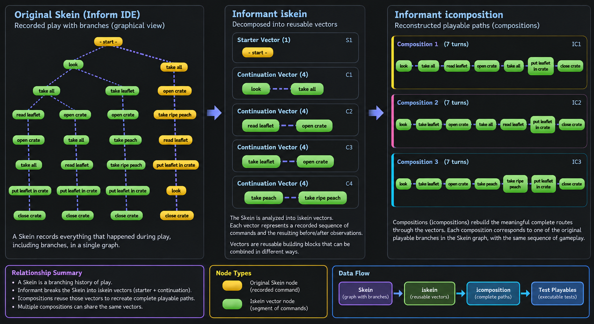

Compile Test Story
==================

To do anything using the test manager you MUST build the project for testing.
Building for testing also enables the use of "test X with" directives as well.
To build the project for testing use the following command::

   Informant: Compile Test Story

From Recorded Skein to Starter Vector
=====================================

``Record Skein`` is the beginning of Informant's native recording workflow. It
generates the source material from which a starter vector can be created. The
author plays the story from its beginning and records a sequence of gameplay.
At this stage the recording is a candidate: the author can inspect the
recorded play and decide whether it represents a useful self-contained
behavioral path.

Conceptually::

    BEGINNING OF STORY
            |
            v
       Record Skein
            |
            v
      recorded gameplay
            |
            v
       review recording
            |
            v
    Accept Starter Vector
            |
            v
         .iskein

When the author accepts the recording as a starter vector, Informant saves it
as an ``.iskein``. This distinction is important: recording produces the
source material; accepting the recording promotes that material into a
reusable Informant test vector.

A starter vector is self-contained gameplay beginning at the beginning of the
story. Because its starting condition can always be recreated by starting a
fresh story, a starter vector can be played independently at any time.

Starter Vectors Establish Reproducible State
============================================

A starter vector has a special role in the testing model because it establishes
its own context::

       FRESH STORY
            |
            v
      Starter Vector
            |
            v
      resulting state

The commands inside the vector are not interpreted as isolated operations.
Together they represent a traversal from a reproducible origin to an observed
story state. This gives Informant a reliable way to recreate the circumstances
under which later gameplay occurred.

A starter vector is therefore both useful gameplay in its own right and a
foundation from which additional recorded behavior can be developed.

Recording Continuation Vectors
==============================

Once a starter vector exists, Informant can use it to create continuation
vectors. A continuation does not begin at the beginning of the game. Instead,
the author first plays back an existing starter vector. That playback recreates
the story state reached by the starter. Recording then continues from that
state.

The workflow is::

    FRESH STORY
         |
         v
    play Starter A
         |
         v
    state established by A
         |
         v
    record continuation
         |
         v
    review continuation
         |
         v
    Accept Continuation Vector
         |
         v
    continuation .iskein

The Test Manager exposes this workflow directly through its Starter Recording
and Continuation Recording controls. A starter recording can be refreshed and
accepted as a Starter Vector. After the required preceding state has been
established, a continuation recording can be accepted as a Continuation
Vector.

This makes continuation vectors deliberately different from starter vectors.
A continuation contains useful recorded gameplay, but it is not independently
playable because it does not establish its own starting state. Its commands
assume that earlier gameplay has already placed the story in the required
condition.

Starter and Continuation Vectors
================================

Both starter and continuation vectors are stored as ``.iskein`` files, but
they have different roles.

A starter vector is independently playable::

    beginning of game
           |
           v
       Starter A
           |
           v
        endpoint

A continuation vector depends upon preceding gameplay::

       required prior state
               |
               v
        Continuation B
               |
               v
            endpoint

The distinction can be summarized as:

* A starter vector begins at the beginning of the game.
* A starter vector is self-contained and can be played independently.
* ``Record Skein`` provides the source material from which a starter vector is
  accepted.
* A continuation vector begins from story state established by preceding
  gameplay.
* A continuation vector is created by playing the required starter path and
  recording additional gameplay from the resulting state.
* A continuation vector cannot be played independently.

This structure allows Informant to preserve useful sections of gameplay
without duplicating the entire path from the beginning of the story every time
a new behavioral segment is recorded.

Vectors as Recorded State Transitions
=====================================

At a high level, an ``.iskein`` vector represents a transition between
observed conditions::

    observed starting condition
               |
               v
        recorded commands
               |
               v
    observed resulting condition

For a starter vector, the starting condition is independently reproducible
because the vector begins with a fresh story. For a continuation vector, the
starting condition must first be established by preceding vectors.

Informant does not need to claim complete knowledge of every internal value in
the Inform virtual machine. Instead, it works with observations at useful
boundaries. A recorded endpoint represents a practical behavioral assertion:

    **After following this recorded path from the required starting condition,
    this is what was observed.**

The important question is not whether every internal variable has exactly the
same value. The useful regression question is whether a reproducible traversal
still produces the behavior the author recorded and expects.

Compositions Reconstruct Complete Playable Paths
================================================

An ``.icomposition`` combines vectors into a complete Playable. Every
composition must begin with a starter vector. The starter establishes the
reproducible path from the beginning of the game. One or more compatible
continuation vectors can then extend that path.

For example::

    Starter A
       |
       v
    Continuation B
       |
       v
    Continuation C

The complete composition is::

    FRESH STORY
         |
         v
      Starter A
         |
         v
    Continuation B
         |
         v
    Continuation C
         |
         v
       endpoint

Neither Continuation B nor Continuation C needs to be independently playable.
The composition supplies the context they require by placing them after the
starter and preceding continuations that establish their starting states.

A composition is therefore more than an arbitrary list of vectors. Its order
describes a valid path through accumulated story state. Informant assists the
author during composition creation by color coding good continuation matches,
helping identify continuation vectors whose recorded boundaries are suitable
candidates for the path being assembled.

Structural compatibility is useful guidance, but the purpose of the completed
composition is behavioral: to reconstruct a meaningful sequence of gameplay
from a reproducible beginning to a useful endpoint.

Why Compositions Matter
=======================

Without compositions, every independently runnable recording would have to
repeat all gameplay from the beginning of the story. That would discard the
reuse made possible by continuation vectors.

Instead, Informant can factor recorded play into reusable pieces::

                         +--> Continuation B
                         |
    Starter A -----------+--> Continuation C
                         |
                         +--> Continuation D

Those pieces can then participate in complete compositions::

    Composition 1 = Starter A + Continuation B
    Composition 2 = Starter A + Continuation C
    Composition 3 = Starter A + Continuation D

Longer compositions can continue through multiple compatible continuation
vectors. The important invariant remains the same: the first vector is always
a starter, and every continuation depends upon the state established by the
path before it.

Qualified Playables
===================

The Test tab describes its candidates as:

    **Independent Playables with qualified start and end endpoints.**

This is why the Test tab does not simply display every ``.iskein``. A starter
vector can be an independent Playable because it begins at the beginning of
the story. A continuation vector cannot appear as an independent test merely
because it contains recorded commands; it requires preceding state. A
composition can become an independent Playable because its required starter
and continuations together reconstruct the complete path.

Conceptually::

    recorded Skein
         |
         v
    Starter Vector --------------------+
         |                              |
         |                              v
         |                      independent Playable
         |
         +--> Continuation Vector(s)
                     |
                     v
                Composition
                     |
                     v
             independent Playable
                     |
                     v
                   TEST

Endpoint qualification adds another layer to this decision. Informant records
information about what is known at the boundaries of the Playable. The
``Step``, ``End``, and ``None`` classifications shown by the Test Manager make
that endpoint information visible. Their precise rules are described with the
endpoint model, but their methodological purpose is important here: endpoint
qualification determines what Informant is entitled to assert about the place
where a recorded traversal begins or ends.

Testing Observations Rather Than Implementations
================================================

Informant's regression model is based on observable behavior. A story may
contain hundreds or thousands of internal values involved in producing a
response, but a behavioral regression test need not depend upon those
implementation details.

Conceptually, Informant asks whether this relationship still holds::

    reproducible starting condition
                |
                v
         recorded traversal
                |
                v
       expected observation

For a starter test, the reproducible condition is the beginning of a fresh
story. For a composition, the starter and its continuations collectively
reconstruct the recorded traversal from that same reproducible origin.

This is behavioral regression testing. It tests the observable consequences of
recorded gameplay rather than attempting to prove that every internal detail
of the story is unchanged.

Nondeterminism and the Limits of an Assertion
=============================================

Interactive fiction can contain intentionally variable behavior. Random
events, alternative descriptions, state-dependent text, and other sources of
variation can make some observations inappropriate for strict literal
comparison. Informant does not need to deny this nondeterminism in order to
provide useful regression testing.

Recorded interactive behavior can contain regions with different degrees of
reproducibility::

             INTERACTIVE STORY
                    |
          +---------+---------+
          |                   |
          v                   v
    stable observable    variable behavior
        behavior
          |                   |
          v                   v
    strong regression     weaker or
       checkpoint         inappropriate
                          literal checkpoint

A stable observation can provide strong regression evidence. An intentionally
variable observation may provide weaker evidence or may be unsuitable for a
strict checkpoint. Nondeterminism therefore defines the limits of an
assertion; it does not invalidate the overall testing model.

The author remains an important part of test design. ``Record Skein`` captures
actual play, but the author decides whether the resulting recording is useful
enough to accept as a starter vector. The author can then deliberately extend
that known path with continuation recordings and assemble those pieces into
compositions representing meaningful scenarios.

The Recording and Testing Methodology
=====================================

The complete native workflow can be summarized as::

    PLAY FROM THE BEGINNING
              |
              v
         Record Skein
              |
              v
      candidate recording
              |
              v
     Accept Starter Vector
              |
              v
       starter .iskein
              |
              +----------------------+
              |                      |
              v                      v
      independent Playable     play starter back
                                     |
                                     v
                              established state
                                     |
                                     v
                           record continuation
                                     |
                                     v
                        Accept Continuation Vector
                                     |
                                     v
                           continuation .iskein
                                     |
                                     v
                              .icomposition
                         starter + continuation(s)
                                     |
                                     v
                          qualified Playable
                                     |
                                     v
                              regression test

This workflow is intentionally incremental. A useful path through the story
becomes a starter. The starter becomes a reproducible foundation for recording
later behavior. Continuations preserve those later segments without requiring
the entire earlier path to be duplicated. Compositions restore the complete
context when those segments need to be executed as an independent Playable.

Collections and Testing Intent
==============================

An ``.icollection`` operates above the recording and composition mechanism. A
collection does not make a continuation independently playable and does not
supply missing behavioral context. Instead, it organizes meaningful Playables
according to the author's testing intent.

For example::

    COLLECTION: Peach Crate

        open-crate-happy-path
        take-ripe-peach
        store-leaflet
        close-crate

Another collection might select a broader group of Playables for release
verification::

    COLLECTION: Release Smoke Tests

        startup
        inventory
        navigation
        peach-crate
        ending

The three Informant file abstractions therefore serve distinct purposes:

``.iskein``
    Recorded behavioral material. An ``.iskein`` may be a self-contained
    starter vector or a continuation vector whose starting state depends upon
    preceding gameplay.

``.icomposition``
    A complete playable path beginning with a starter vector and followed by
    one or more compatible continuation vectors.

``.icollection``
    Organization of Playables according to testing intent and strategy.

Independent Test Execution
==========================

Each independent test begins with a fresh story. This is a direct consequence
of the starter-vector model. Whether the selected Playable is a starter by
itself or a composition containing a starter and continuations, its complete
execution begins from the beginning of the game.

Thus independent tests behave conceptually as::

    fresh story -> Starter A --------------------------> PASS

    fresh story -> Starter B -> Continuation C -------> PASS

    fresh story -> Starter D -> Continuation E
                             -> Continuation F --------> PASS

One test therefore does not silently inherit the state left behind by another.
This is intentionally different from executing every test as one continuous
story session, where a side effect introduced by an earlier test could alter
the result of a later test.

What a Passing Test Means
=========================

A successful Informant test run is regression evidence, not proof that the
entire story is correct. When the Test Manager reports that a set of tests
passed, the useful interpretation is:

    **The independently runnable Playables began from reproducible starting
    conditions, traversed their recorded command sequences through the required
    starter and continuation vectors, and reached observations consistent with
    their recorded expectations.**

This is deliberately narrower and more defensible than claiming that the
entire story has been proven correct.

Methodology Summary
===================

Informant builds regression tests from recorded gameplay rather than treating
individual commands as isolated test cases. ``Record Skein`` captures a
candidate self-contained path beginning at the start of the game. Accepting
that recording creates a starter ``.iskein`` that can be played independently.
Playing a starter recreates a known story state from which additional
continuation ``.iskein`` vectors can be recorded. Continuations are reusable
segments but cannot be played independently because they do not begin at the
start of the game.

An ``.icomposition`` restores the complete context by beginning with a starter
vector and extending it with one or more compatible continuation vectors.
Informant assists composition creation by identifying and color coding good
continuation matches. Endpoint qualification further describes what is known
at the boundaries of the resulting Playable. ``.icollection`` files then
organize meaningful Playables into broader testing strategies.

The result is a testing methodology suited to stateful interactive fiction:

    **Record a reproducible path, preserve reusable transitions, reconstruct
    the context they require, and make regression assertions only where the
    recorded boundaries justify them.**

Choosing A Verification Type
============================

Informant separates the construction of a Playable from the way that Playable
is verified. Starter and continuation vectors describe how a path through the
story is constructed. The verification style belongs to the completed,
independently playable test.

Only two kinds of Playable can have a verification style:

* a Starter Vector, because it begins at the beginning of the game and can be
  played independently; or
* a Composition, because it begins with a Starter Vector and reconstructs a
  complete path using any required Continuation Vectors.

Continuation Vectors do not have independent ``Step``, ``End``, or ``None``
verification styles. They are reusable structural components whose required
starting state is supplied by the Starter Vector and any preceding
Continuation Vectors in a Composition.

For example::

    Starter A [Step]

and::

    Composition B [End]
        |
        +-- Starter A
        +-- Continuation 1
        +-- Continuation 2

are independently playable tests with verification styles. The Continuation
Vectors inside Composition B do not carry separate verification styles.

The choice between ``Step``, ``End``, and ``None`` expresses how the author
wants the completed Playable to participate in regression verification. It
allows a test to reflect the difference between deterministic behavior,
legitimate variation, and gameplay that is useful to execute without treating
every observation as a regression assertion.

Case 1: Step -- The Journey Is Evidence
=======================================

Consider a deterministic puzzle in which the player unlocks a display case,
opens it, takes a ruby, and checks inventory::

    > unlock display case with brass key
    You unlock the display case.

    > open display case
    You open the display case.

    > take ruby
    Taken.

    > inventory
    You are carrying:
      a brass key
      a ruby

Suppose this sequence is represented by an independently playable Composition::

    Composition: Acquire the Ruby [Step]
        |
        +-- Starter: Reach the Gallery
        +-- Continuation: Unlock the Display Case
        +-- Continuation: Take the Ruby

The verification style belongs to ``Acquire the Ruby`` as a whole. It does not
belong separately to ``Unlock the Display Case`` or ``Take the Ruby``.

``Step`` is appropriate when the behavior along the completed path is expected
to be stable and those observations are useful regression evidence. The author
cares not only that the Playable eventually reaches its destination, but that
the expected interaction continues to occur as the route is traversed.

Conceptually::

    START
      |
      v
    unlock case  ---> expected behavior
      |
      v
    open case    ---> expected behavior
      |
      v
    take ruby    ---> expected behavior
      |
      v
    inventory    ---> expected behavior

**Use Step when the journey itself is evidence.**

Step is particularly useful for stable puzzle solutions, command sequences,
object interactions, conversations with predictable responses, and other
gameplay where intermediate behavior is intentionally repeatable.

Case 2: End -- The Destination Is Evidence
==========================================

Now consider a journey through an enchanted forest. The route is valid and
repeatable, but the story deliberately varies some atmospheric responses::

    > north
    A crow erupts from the branches.

    > north
    Rain rattles suddenly through the leaves.

    > east
    Something small moves through the ferns.

    > enter tower

    Moon Tower
    A circular stone chamber surrounds you. A silver bell
    stands upon a pedestal.

On another valid run, the same gameplay might include different incidental
responses, while still ending at Moon Tower. The author does not want
legitimate variation during the journey to make the test unreliable. What
matters is that the completed Playable reaches the stable destination.

The test might therefore be constructed as::

    Composition: Reach Moon Tower [End]
        |
        +-- Starter: Enter the Forest
        +-- Continuation: Cross the Forest
        +-- Continuation: Enter the Tower

The ``End`` style applies to ``Reach Moon Tower`` as a complete Composition.
It is not assigned separately to ``Cross the Forest`` or ``Enter the Tower``.

Conceptually::

    START
      |
      v
    variable behavior
      |
      v
    variable behavior
      |
      v
    variable behavior
      |
      v
    MOON TOWER  ---> useful stable endpoint

**Use End when the destination is evidence.**

End is useful when a Playable crosses intentionally variable material but is
expected to arrive at a stable and meaningful result.

Case 3: None -- Do Not Invent Evidence
======================================

Some Playables are useful even when the author does not want their observations
to serve as verification evidence. Imagine a procedural dream sequence whose
locations, descriptions, characters, or events deliberately vary. The sequence
may still be useful to preserve and replay, but its output may not provide a
reliable regression assertion.

For example::

    Starter: Experience the Dream [None]

or::

    Composition: Dream Passage [None]
        |
        +-- Starter: Go to Sleep
        +-- Continuation: Traverse the Dream
        +-- Continuation: Wake

The Continuation Vectors remain parts of the Composition. ``None`` belongs to
the completed ``Dream Passage`` Playable.

Choosing ``None`` does not mean that the gameplay is unimportant. It means
that the author is deliberately declining to treat the Playable's observations
as the kind of evidence represented by the other verification styles. This is
preferable to manufacturing a fragile assertion around behavior that the story
was designed to vary.

**Use None when the Playable is useful, but its observations should not be
treated as verification evidence.**

Three Different Testing Intentions
==================================

The three styles can be summarized in terms of what the author intends to
claim about the complete Playable::

    STEP
        The journey is evidence.
        Stable behavior along the Playable matters.

    END
        The destination is evidence.
        Intermediate variation may be legitimate, while the completed
        Playable is expected to reach a useful stable endpoint.

    NONE
        Do not invent evidence.
        The Playable is useful, but its observations are not being used as
        the corresponding regression assertion.

The verification style should therefore be chosen according to the behavior
the story promises, not simply according to how much recorded output is
available.

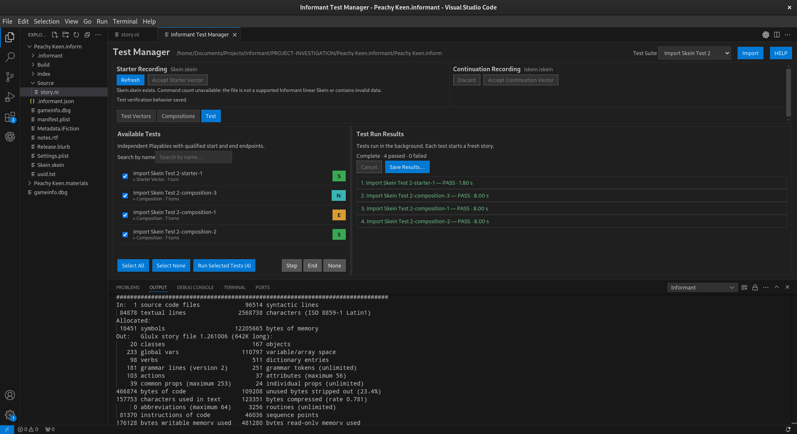

Creating Reliable Tests
=======================

A reliable Informant test should assert behavior that the author genuinely
expects the story to preserve. The goal is not to maximize the amount of
recorded material being compared. The goal is to select useful invariants in a
stateful and sometimes deliberately variable interactive experience.

A useful rule is:

    **Test the behavior the story promises, not every behavior the story
    happens to produce.**

Choose Purposeful Playables
===========================

A good Starter or Composition should represent a behavior the author can
describe clearly: acquire an object, solve a puzzle, reach a location, complete
a conversation, activate a machine, trigger a scene, or reach an ending.

Ask:

    **What do I expect this completed Playable to demonstrate?**

If the answer concerns stable behavior throughout the traversal, ``Step`` may
be appropriate. If the route may vary but its result should remain stable,
``End`` may be the stronger test design. If neither observation is a reliable
assertion, ``None`` avoids turning legitimate variation into noise.

Keep Starter Vectors Focused
============================

A Starter Vector establishes reproducible state from the beginning of the
game. Prefer a Starter that establishes a useful common foundation rather than
duplicating a long path for every later scenario::

                          +--> Continuation: test vault
                          |
    Starter: reach lab --+--> Continuation: test machine
                          |
                          +--> Continuation: test specimen

The Starter can be played to recreate its known state, after which different
Continuation Vectors can record the behaviors that branch from it.

Use Continuations to Factor Shared Gameplay
===========================================

Continuation Vectors are useful when several scenarios share the same setup.
Record the reproducible setup as a Starter, play that Starter to recreate its
state, and record different continuations from there. Compositions can then
reconstruct independent tests::

    Composition A [Step]
        Starter: Reach Laboratory
        Continuation: Test Vault

    Composition B [End]
        Starter: Reach Laboratory
        Continuation: Test Machine

The verification style belongs to Composition A and Composition B. It is not
assigned to the Continuation Vectors from which they are built.

Do Not Over-Assert
==================

More verification does not automatically make a stronger test. If a Playable
contains behavior that is intentionally variable, demanding deterministic
evidence from that variation can create a test that fails while the story is
working correctly.

Choose the verification style according to the strongest reliable claim the
completed Playable can support:

* choose ``Step`` when stable behavior throughout the path matters;
* choose ``End`` when intermediate variation is acceptable but the final
  result provides useful evidence; and
* choose ``None`` when the Playable should not make that verification claim.

A test that asserts less, but asserts something genuinely stable, can provide
better regression evidence than a test that attempts to verify everything.

Treat Repeated Instability as Information
=========================================

If a test produces different results repeatedly without a corresponding source
change, investigate whether the test is asserting behavior that was never
intended to remain constant. A Playable whose journey is too variable for
``Step`` may still have a useful stable endpoint for ``End``. A Playable
without a suitable stable assertion may still be worth retaining with
``None``.

The verification style should describe the nature of the interactive
experience rather than forcing the experience to conform to the test.

Prefer Meaningful Behavioral Boundaries
=======================================

Useful Playables tend to end at meaningful changes in the fictional world: an
object has been acquired, a door has been unlocked, a room has been reached, a
conversation has completed, a scene has begun, a puzzle has been solved, a
machine has been activated, or an ending has been reached.

These boundaries make it easier to understand what a test protects and why a
failure matters.

Keep Independent Tests Independent
==================================

A Starter begins at the beginning of the game, and a Composition begins with a
Starter. Consequently, an independently runnable test contains the context it
needs to reproduce its own path::

    fresh story -> Starter A --------------------------> PASS

    fresh story -> Starter B -> Continuation C -------> PASS

    fresh story -> Starter D -> Continuation E
                             -> Continuation F --------> PASS

One test should not depend upon another test having run first. Required setup
belongs inside the Starter and Continuation structure of the Playable itself.
This keeps failures reproducible and prevents execution order from silently
becoming part of the test.

A Practical Rule
================

When choosing a verification style for a Starter or Composition, ask what the
completed Playable is intended to prove::

    Does the behavior along the path need to remain stable?
        Choose Step.

    May the journey vary while the destination must remain stable?
        Choose End.

    Would verification turn legitimate variation into a false failure?
        Choose None.

The distinction is not between important and unimportant gameplay. It is
between different kinds of evidence.

``Step`` says that the journey is evidence. ``End`` says that the destination
is evidence. ``None`` says that the Playable remains useful, but Informant
should not invent evidence where the interactive experience does not provide
a reliable assertion.

   
####################################
Toolchains
####################################

Informant uses self-contained toolchains rather than depending on an Inform
installation elsewhere on the computer. The VS Code extension and compiler
environment are distributed separately, allowing Informant to install and
manage the Inform environment used by a project without changing another
Inform installation on the system.

An Informant Toolchain contains the native compiler programs together with the
Inform resources, documentation, extensions, templates, and player components
needed for the normal development workflow. Toolchains are available for each
supported operating system and share the same general package organization.

At a high level, a toolchain contains::

    PACKAGE/
    |
    +-- Compilers/
    +-- Documentation/
    +-- Extensions/
    +-- HTML/
    +-- Imagery/
    +-- Inter/
    +-- Languages/
    +-- Miscellany/
    +-- Pipelines/
    +-- Player/
    +-- REDIST/
    +-- Templates/

The exact contents can vary between releases, but each directory has a clear
role in providing the complete Inform development environment used by
Informant.

Toolchain Components
====================

``Compilers/``
    Contains the native ``inform7``, ``inform6``, and ``inblorb`` programs for
    the target operating system. These programs provide the principal compile
    and release pipeline used by Informant.

``Inter/`` and ``Pipelines/``
    Contain Inform's kits and processing definitions used by the compiler.
    These resources form part of the version-matched Inform environment.

``Extensions/`` and ``Languages/``
    Provide the standard Inform extensions and language resources included
    with the selected Inform release. Extensions installed separately by the
    user remain distinct from those supplied by the toolchain.

``Documentation/`` and ``Imagery/``
    Provide Inform documentation and supporting images used by the
    documentation and generated Index.

``Templates/``, ``HTML/``, and ``Miscellany/``
    Provide release templates, web presentation resources, Index resources,
    and other supporting material used by Inform during compilation and
    release.

``Player/``
    Contains the Quixe/GlkOte browser-player resources used by Informant for
    integrated Glulx playback.

``REDIST/``
    Contains redistribution and licensing material for components included in
    the packaged toolchain.

Compilation
===========

For Inform 10, the principal compiler pipeline can be summarized as::

    Inform 7 source
          |
          v
       inform7
          |
          v
    generated Inform 6 source
          |
          v
       inform6
          |
          v
      story file
          |
          +------> inblorb for packaged release output

The compiler programs work with the surrounding kits, extensions, languages,
pipelines, and release resources. Informant therefore manages the toolchain as
a complete package rather than as a collection of independent executables.

Platform Packages
=================

Informant provides toolchain packages for Windows, macOS, and Linux. The
overall package organization is consistent across platforms, while the native
programs in ``Compilers/`` are built for the operating system and architecture
of each package.

The macOS toolchain is distributed as a universal package supporting Intel and
Apple silicon. Windows and Linux use their corresponding native x86-64
packages.

Installing a toolchain does not replace or modify another Inform installation.
Informant stores its managed toolchains separately and uses the toolchain
selected for the current project.

Versioned Environments
======================

A toolchain represents a matched Inform environment. Its compiler programs and
supporting resources belong to the same toolchain release, giving Informant a
predictable set of files to use when compiling, playing, documenting, and
releasing a project.

Conceptually::

    Informant
       |
       v
    selected toolchain
       |
       v
    PACKAGE/
       |
       +-- compiler programs
       +-- Inform kits and pipelines
       +-- standard extensions and languages
       +-- documentation and imagery
       +-- release resources
       +-- integrated player

This separation also allows more than one toolchain to be installed. A project
can select an appropriate installed toolchain without requiring a system-wide
change to Inform.

Toolchain Sources and Releases
==============================

Informant toolchains are assembled from the Inform ecosystem and packaged for
use by Informant. Build automation, source information, and downloadable
releases are maintained in the Informant toolchain repository:

* `Informant Toolchain Actions <https://github.com/interactivefiction/informant-toolchains/actions>`_
* `Informant Toolchain Releases <https://github.com/interactivefiction/informant-toolchains/releases>`_

The toolchain is distributed separately from the Informant VS Code extension.
Licensing information for Informant and the components used by the toolchain
is provided in the Licensing section of this documentation.

Install Toolchain
=================

To obtain and install a toolchain supported by Informant use::

   Informant: Install Toolchain

Manage Toolchains
=================

To inspect and manage the toolchains currently available to Informant use::

   Informant: Manage Toolchains

Informant Storage
=================

To open the location where Informant maintains its managed application data,
including installed toolchain material use::

   Informant: Reveal Informant Storage

The storage area is managed by Informant and is separate from an Inform
installation that may already exist elsewhere on the computer.

####################################
Resources
####################################

The following resources provide online help for Visual Studio Code, Visual
Studio Code extensions, Inform, and interactive fiction development.

Visual Studio Code
==================

* `Visual Studio Code Documentation <https://code.visualstudio.com/docs>`_
* `Getting Started with Visual Studio Code <https://code.visualstudio.com/docs/getstarted/overview>`_
* `Visual Studio Code Workspace Trust <https://code.visualstudio.com/docs/editing/workspaces/workspace-trust>`_
* `Visual Studio Code Extension Marketplace Documentation <https://code.visualstudio.com/docs/configure/extensions/extension-marketplace>`_
* `Using Visual Studio Code Extensions <https://code.visualstudio.com/docs/configure/extensions/extensions>`_
* `Visual Studio Code Extension API <https://code.visualstudio.com/api/>`_

Inform
======

* `Inform 7 <https://inform7.com/>`_
* `Inform GitHub Organization <https://github.com/ganelson/inform>`_
* `Interactive Fiction Technology Foundation <https://iftechfoundation.org/>`_
* `Interactive Fiction Community Forum <https://intfiction.org/>`_
* `IFWiki <https://www.ifwiki.org/>`_

Informant
=========

Informant-specific project, issue, release, and online-help links should be
listed here once their public release locations are finalized.

####################################
Licensing
####################################

Overview
========

Informant and the Inform toolchain are **separate** software components.
Informant-managed toolchains contain software originating from the Inform
project and remain subject to the licenses supplied with those components.

Informant VSCode Plugin
=======================

The Informant VS Code extension is free software released by OpcodeASM under the 
**GNU General Public License, version 3 only (GPL-3.0-only)**. You are free
to use, study, modify, and redistribute Informant under the terms of
that license. The complete license terms are provided in the ``LICENSE`` 
file distributed with Informant.

Informant Inform Toolchain Software Bill of Materials
=====================================================

The optional Informant Inform 7 Toolchain is a curated distribution of supporting 
components, each of which remains subject to its respective copyright and license 
terms.

.. list-table:: Software Bill of Materials
   :widths: 24 46 30
   :header-rows: 1

   * - Component
     - Role
     - License
   * - Inform 10.1.2
     - Inform compiler and supporting toolchain resources
     - Artistic License 2.0, except where otherwise stated
   * - Inweb 7.2.0
     - Inform build and development tooling
     - Artistic License 2.0
   * - Intest 2.1.0
     - Inform testing and build tooling
     - Artistic License 2.0
   * - Inform Website
     - Inform documentation and supporting resources
     - Artistic License 2.0
   * - Quixe / GlkOte
     - Browser-based Glulx interpreter and player components
     - MIT License
